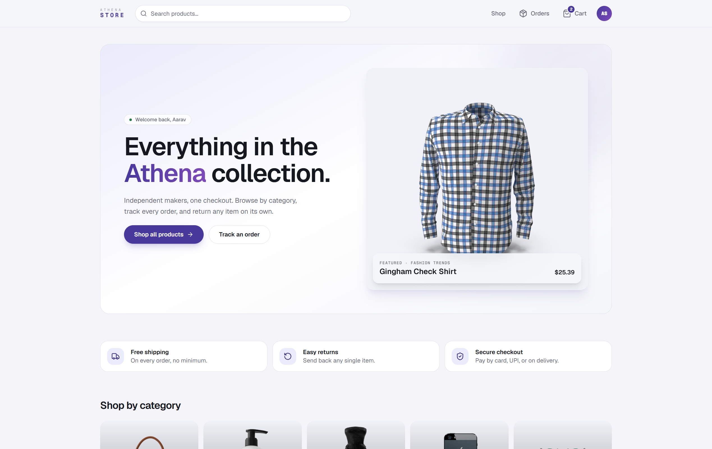
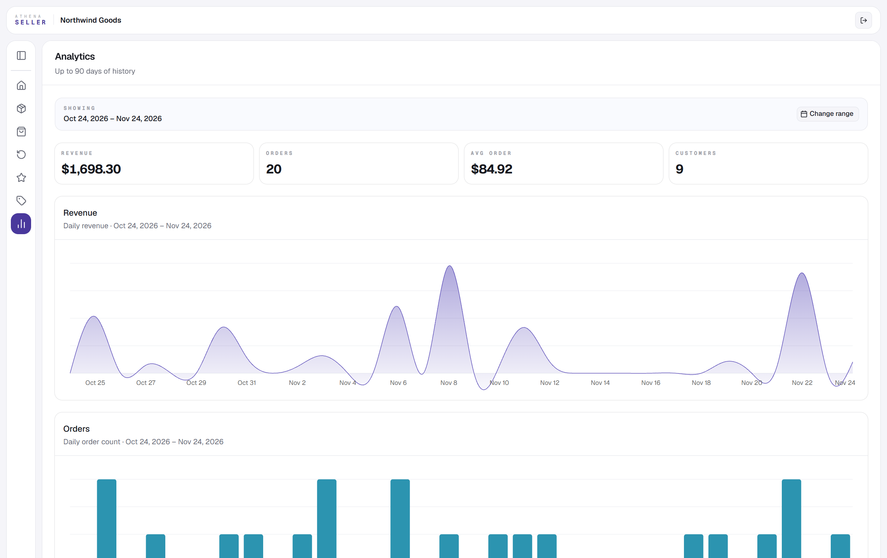

# Athena

A complete, production-ready multi-seller e-commerce platform built with Next.js. Athena pairs a customer storefront with a dedicated seller dashboard. Together they cover the full commerce lifecycle, from catalogue and checkout to fulfilment, returns, reviews and analytics.

## Storefront [\[LINK\]](https://athena-storefront.vercel.app)

## Seller Dashboard [\[LINK\]](https://athena-store-tau.vercel.app)

